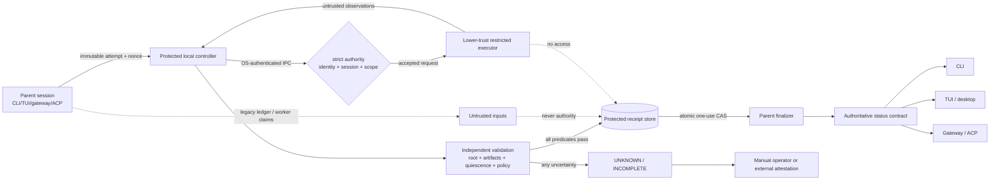

# FHM-005 detailed design candidate

**Status: CANDIDATE — implementation task breakdown ready, NOT architecture sign-off or approval to deploy.**

| Field | Value |
| --- | --- |
| Project | `fermes-hermes` |
| Issue | [FHM-005 / #5](https://github.com/fredheathcote007/hermes-agent/issues/5) |
| Branch baseline | `fermes/fhm005-detailed-design-20261027` at `120d7e3241621a72b66a5d09c25cb23d707f5ceb` |
| Scope | Protected local controller, restricted executor, authoritative receipt, and status propagation |
| Approved constraints | DEC-004 fail closed; DEC-005 native Linux **and** Windows; DEC-006 unprivileged-worker threat model and manual/external fallback |
| Architecture disposition | Draft candidate; DR-02 through DR-07 remain owner decisions |
| Default-on | Explicitly out of scope; trusted mode remains opt-in |

This document turns the ARB candidate into an implementation plan. It does not approve the target,
claim that the current source is independently trusted, accept a Critical/High risk, or authorize a
merge, deployment, service installation, or default-on change. The retained ARB and reviewer records
remain authoritative evidence: [ARB review](ARB-REVIEW-20261027.md), [trust-boundary candidate](TRUST-BOUNDARY-CANDIDATE.md),
[validation matrix](VALIDATION-MATRIX.md), and [review evidence](review-evidence/FIRST-PASS-ALL.md).

## 1. Identity, decisions, and baseline

The maintained fork is `fredheathcote007/hermes-agent`, project `fermes-hermes`. FHM-007 remains a
separate active workstream and must not be edited, rebased, reset, or made dependent on this design.
Merged source PR #21 and PR #22 are source inputs to this work; draft ARB PR #23 and TUI PR #24 are
not merged implementation. Existing review evidence and [DECISIONS.md](../../memory/DECISIONS.md) are not
modified by this candidate.

The approved policy and scope are deliberately narrower than a trusted implementation:

* DEC-004 requires missing, failed, stale, untrusted, or unobservable proof to remain incomplete;
  uncertain external effects must not be replayed.
* DEC-005 requires one qualification result on native Linux and native Windows. Simulation,
  emulation, skip, timeout, or environment-blocked execution is not a pass.
* DEC-006 includes compromised delegated workers and unprivileged local processes. Local
  root/Administrator or equivalent host compromise is outside the initial guarantee. Manual operator
  verification or externally attested verification is the fail-closed fallback.
* Trusted verification is opt-in and remains unavailable when installation, identity, IPC, policy,
  storage, or containment cannot be proven.

The current source is useful as a compatibility seam, not as a trust boundary:

* `agent/verification_evidence.py` stores profile-local SQLite rows and `record_verify_run()` accepts
  caller-provided result fields. Its ledger is diagnostic and may feed the existing opt-in guard;
  it cannot mint a trusted receipt.
* `agent/turn_verification_finalize.py` already makes unreadable or unresolved evidence fail closed,
  but reads and retires the legacy state rather than consuming a protected per-attempt receipt.
* `tools/delegate_verification.py` durably binds child telemetry to session, attempt, task index, and
  authority, but worker telemetry is not independent authority.
* `agent/verify/runner.py` executes recipe-controlled commands with `shell=True` and current
  process cleanup does not establish equivalent descendant containment on both operating systems.
* `tui_gateway/prompt_turn.py:_result_status()` currently checks interruption/error before unresolved
  verification, so a result carrying `completed=false`, `failed=true`, and
  `verification_unresolved=true` can be rendered as `complete`. This is a concrete consumer defect,
  not evidence that the current path is trusted.

## 2. Threat model and trust boundary

### In scope

The design protects the parent/controller decision from a compromised project worker, a malicious
delegated child, a same-user or otherwise unprivileged unrelated local process, forged worker output,
legacy ledger edits, cross-session telemetry, receipt replay, stale evidence, path substitution,
symlink/junction/reparse-point races, detached descendants, controller/parent crashes, and unsupported
or ambiguous external effects. It also treats a malformed, missing, late, or contradictory message as
uncertain rather than as an empty no-effect trace.

### Explicitly out of scope

Compromise of local root, Windows Administrator, a kernel-equivalent principal, or a host that can
replace the service binary, inspect or alter trusted memory, or defeat the OS security model is outside
the initial local guarantee. Cryptographic signatures or MACs cannot repair that boundary. Extending
the guarantee requires remote or hardware-backed attestation and a separate owner decision.

### Authority rules

1. The parent owns the user-visible task but is not receipt authority.
2. The protected controller is the only component allowed to mint or consume a trusted receipt.
3. The restricted executor is lower trust. Project recipes, manifests, environment files, command
   strings, output, exit codes, paths, and worker claims are inputs, never provenance.
4. The controller never executes untrusted project shell under its own identity and never supplies
   receipt-store access, signing material, profile secrets, or broad network access to the executor.
5. No component silently escalates privileges. Installation elevation is separate from normal runtime
   identity; an interactive or same-user fallback is diagnostic/manual mode only.

## 3. Candidate architecture



### Request-to-status sequence

```mermaid
sequenceDiagram
    participant P as Parent
    participant C as Controller
    participant E as Restricted executor
    participant R as Protected receipt store
    participant F as Finalizer

    P->>P: Create immutable attempt, nonce, scope, policy digest
    P->>C: Authenticated submit(attempt, contract, root identity)
    C->>C: Derive peer identity; validate authority and protocol
    C->>E: Launch constrained worker in disposable boundary
    E-->>C: Exit/output/artifact observations (untrusted)
    C->>C: Drain, quiesce, re-stat/hash, validate effect/readback
    alt every required predicate passes
        C->>R: Atomically mint protected fresh receipt
        P->>F: Consume exact receipt with expected generation
        F->>R: One-use CAS consume
        R-->>F: VERIFIED
    else failure, ambiguity, crash, stale or unsupported effect
        C->>R: Persist UNKNOWN/FAILED with fence, if possible
        R-->>F: UNKNOWN / INCOMPLETE / UNAVAILABLE
    end
    F-->>P: One machine-readable status for all surfaces
```

### Components and ownership

| Component | Trust | Owns | Must not do |
| --- | --- | --- | --- |
| Parent/finalizer | User-session authority, not verifier authority | Attempt request, final status projection, user resolution | Accept worker `ok`, legacy SQLite, or prose as proof; replay uncertain work |
| Controller | Protected authority | OS-authenticated request handling, policy, executor lifecycle, independent validation, receipt minting | Run project-authored tests with authority; trust client-supplied identity; downgrade errors |
| Restricted executor | Lower trust | Disposable process tree and untrusted check observations | Read receipt state/secrets; call controller as a privileged peer; escape root/resource limits |
| Receipt store | Protected authority-owned state | Immutable attempt history and one-use receipt state | Be writable by parent profile or worker; allow cross-session retirement |
| Surface adapters | Presentation only | Render the status contract and safe next action | Recompute “success” from text, exit code, or legacy fields |
| Manual/external resolver | Human or external authority | Resolve cases automated local proof cannot establish | Manufacture a local trusted receipt or automatically replay an effect |

Prefer an on-demand controller with bounded lifecycle and explicit installation health over an
always-on daemon. A future owner-approved implementation may keep a service resident for latency, but
the trust and release contracts must not depend on that optimization.

## 4. Shared Python contract

The first implementation seam is a pure Python DTO and state-machine module with no OS process, IPC,
filesystem, or UI imports. Later adapters must use it rather than create parallel status logic.

### DTOs

Names are candidate names; the exact public/internal module path is an implementation task, not an
architecture approval.

```text
VerificationAttempt
  attempt_id: opaque UUID
  nonce: 256-bit random opaque value, never displayed as a secret
  parent_session_id: immutable session identity
  parent_authority: authenticated transport/profile authority
  canonical_root: root identity (device/volume + object identity + canonical path)
  scope: immutable artifact set, acceptance contract, effect class
  policy_digest: SHA-256 of policy/protocol/check selection
  protocol_version: supported contract version
  created_at / expires_at: controller time
  supersedes: optional prior attempt, never an implicit retry

ArtifactIdentity
  relative_path: canonical relative path only
  object_identity: inode/device on Linux or file ID/volume on Windows
  content_sha256: post-worker content digest where applicable
  metadata_generation: platform-specific generation/version evidence
  link/reparse/mount disposition: explicit, not inferred from text path

VerificationObservation
  executor_id, owned_process_set, terminal state, exit code
  stdout/stderr classification (redacted, bounded, non-authoritative)
  artifact identities before/after
  external_effect_observation: contract-specific readback or absent

ProtectedReceipt
  receipt_id, attempt_id, nonce, parent_authority
  root identity, exact artifact identities/digests, policy/protocol digest
  executor generation and quiescence proof
  effect contract/readback evidence
  issued_at, expires_at, verifier_generation
  state: issued | consumed | expired | rejected
  store_generation: CAS fence

VerificationStatus
  state: verified | failed | unknown_incomplete | verifier_unavailable |
         cancelled_interrupted
  attempt_id, effect_class, reason_code, safe_next_action
  receipt_id only when policy permits; no raw secret/path leakage
```

DTO construction rejects unknown fields, missing binding fields, invalid state transitions, expired
times, non-canonical scope, and client-provided authority claims. Serialization is versioned and
length-bounded. Secrets, raw command text, absolute paths, and unrestricted output do not enter the
authoritative receipt.

### State machine

```text
created -> submitted -> authenticated -> running -> observing
observing -> validating
validating -> receipt_issued       (all predicates pass)
validating -> failed               (authoritative check failed)
created/submitted/running/observing/validating -> unknown_incomplete
submitted/running -> verifier_unavailable (controller/IPC/policy unavailable)
receipt_issued -> consumed         (one exact CAS)
receipt_issued -> expired           (freshness window elapsed)
receipt_issued -> rejected          (binding, generation, or policy mismatch)
unknown_incomplete -> resolved_manual | resolved_external
```

`unknown_incomplete` is sticky after dispatch is durable. A crash, lost response, late child,
unreadable store, survivor, post-check mutation, or ambiguous external effect cannot be converted to
`failed` or `verified` by retry. A new attempt may be created only after explicit inspection and is
linked by `supersedes`; it never replays automatically. All state updates use an expected generation
and one transaction. Receipt evaluation and retirement are one atomic operation or neither occurs.

## 5. Strict IPC and platform adapters

The controller authenticates the peer from the operating system, not from a client field. The request
contains a nonce and scope reference, but the controller derives peer identity, profile ownership,
and installation generation itself. A client cannot choose `ok`, session, root, receipt ID, policy,
executor identity, or output as authority. Protocol downgrade, unknown fields, oversized messages,
duplicate nonce, mismatched parent authority, and stale generation are rejected.

### Linux candidate

* Install a dedicated non-login system service UID and protected service-owned state directory. The
  controller runtime does not run as project user and does not execute under root.
* Expose a root-owned or service-owned Unix-domain socket with restrictive mode/DACL-equivalent and
  validate `SO_PEERCRED`/peer credentials plus expected UID, group, process relationship where
  applicable, and profile/installation binding.
* Use systemd service hardening and a per-attempt cgroup or equivalent ownership mechanism for worker
  containment. Verify actual kernel/systemd behavior on supported distributions; configuration text
  alone is not evidence.
* Reject socket replacement, wrong owner/mode, user-service fallback, missing cgroup ownership,
  unavailable peer credentials, and post-install unit tampering as `verifier_unavailable`.

### Windows candidate

* Install a noninteractive SCM service using an explicitly selected service identity/service SID and
  protected state directory. Installation may require elevation; normal verification must not.
* Create an explicit named-pipe security descriptor/DACL and validate the connecting token, expected
  service/profile relationship, impersonation level, protocol generation, and pipe instance ownership.
  Pipe name secrecy is not authentication.
* Launch every executor inside a Windows Job Object with kill-on-close and resource limits; prove
  descendant membership, orphan handling, restart, file-lock, and reparse-point behavior.
* Reject `InteractiveToken`, Startup-folder fallback, inherited interactive credentials, permissive
  DACL, pipe substitution, service SID mismatch, and incomplete Job Object containment as
  `verifier_unavailable`.

The existing gateway service mechanisms are not reused as proof of a verifier boundary. Any shared
installer helpers must be separately reviewed for identity, ACL, upgrade, rollback, and profile
scope.

## 6. Executor isolation and proof predicates

The controller may select only a policy-owned check contract. Project recipes are untrusted inputs
and run, if supported at all, in an isolated executor:

* disposable exported worktree or snapshot; no controller receipt directory, profile database,
  credential files, service socket/pipe, private keys, or unrestricted parent environment;
* allowlisted environment and working directory; no inherited secrets;
* deny-by-default network/IPC/device/mount access and explicit resource budgets for CPU, memory,
  disk, output, wall time, concurrency, and child count;
* fixed executable resolution and argument structure where the policy requires it; the current
  `shell=True` runner cannot be promoted into trusted authority;
* output is bounded, redacted, diagnostic only; an exit code or convincing output is not provenance;
* termination drains bounded pipes, proves all owned descendants quiesced, and checks for late writes
  before minting a receipt.

The controller must independently establish all relevant predicates:

1. authenticated peer and valid installation generation;
2. exact attempt nonce, parent/session authority, scope, protocol and policy digest;
3. canonical root identity and immutable/observed artifact set;
4. pre/post object identity and SHA-256 (or an approved immutable snapshot/generation proof);
5. no symlink, hardlink, junction, reparse point, mount, rename, case/volume, or concurrent-session
   substitution across the check and readback window;
6. worker terminal state, complete owned process set, resource-limit outcome, and no late mutation;
7. action-specific authoritative readback for any external effect;
8. fresh receipt within expiry, with one-use CAS and no prior consumption.

Path strings, mtimes, worker-reported hashes, same-profile SQLite rows, PID alone, an exit code,
or a parent process exiting are insufficient predicates.

## 7. Receipts, privacy, and crash consistency

The receipt store is controller-owned and inaccessible to the executor. The parent may submit an
attempt and consume an exact receipt but cannot write, edit, or retire one. The store records an
append-only attempt history plus a current CAS-protected state. It must support atomic:

```text
read exact (attempt_id, nonce, parent_authority, generation)
  -> validate freshness/binding/state
  -> mark consumed with expected generation
```

Any crash before the commit point leaves `unknown_incomplete` or an unconsumed receipt requiring
operator inspection. A crash after consume cannot make the receipt available again. A controller
restart fences its prior verifier generation. An upgrade or rollback invalidates receipts from an
unrecognized generation and preserves affected attempts as unknown.

The authoritative record is minimal: opaque IDs, relative paths or approved digests, structured
reason codes, effect class, policy/protocol digest, timestamps, and bounded redacted diagnostics.
Raw commands, absolute roots, output tails, and personal data are local diagnostic material only,
with explicit retention and purge policy. Redaction is tested against secrets and personal paths;
truncation alone is not redaction. The user-facing prompt must not receive raw receipt output by
default.

## 8. External effects and manual fallback

Local file/test evidence cannot prove browser clicks, `execute_code`, connector calls, deployment,
email, SaaS mutation, remote API acceptance, or eventual consistency. Each supported effect class
needs an acceptance contract defining request identity, authoritative readback source, scope, freshness,
and reconciliation behavior. A timeout after remote acceptance is `unknown_incomplete`, not a safe
retry. Unsupported or unavailable readback goes to manual operator verification or external attestation.

Manual resolution must display the attempt, scope, effect class, observed evidence, and reason for
uncertainty. It records who/what resolved the case and when, but must not pretend that a local
controller minted an automated trusted receipt. External attestation must identify its issuer,
artifact/scope, freshness, and verification method. Neither path automatically replays the original
effect.

## 9. One status contract across surfaces

The finalizer owns the machine result and every surface receives the same state and reason code.

| State | Meaning | `completed` | Safe next action |
| --- | --- | --- | --- |
| `verified` | Exact fresh protected receipt consumed once | `true` | Report success |
| `failed` | Authoritative check ran and failed | `false` | Inspect failure; a new attempt is explicit |
| `unknown_incomplete` | Missing/stale/malformed/ambiguous proof or possible effect | `false` | Inspect/resolve; never auto-replay |
| `verifier_unavailable` | Controller, identity, IPC, policy, storage, or native gate unavailable | `false` | Manual/external verification or retry after inspection |
| `cancelled_interrupted` | User/system cancellation; effect status remains explicit | `false` unless a prior verified receipt exists | Inspect possible effects |

CLI, TUI/desktop, gateway, and ACP must render the same state, attempt/effect summary, reason, and
next action. TUI reducer logic must test unresolved/failed before success. Gateway/API projections must
preserve the state rather than map all non-exception results to “completed”. ACP cancellation must not
erase an outstanding unknown attempt. No surface may offer a generic automatic retry for an uncertain
external effect; “inspect”, “resolve manually”, and “retry after inspection” are distinct actions.

## 10. Demonstrable versus unprovable

### Demonstrable by the candidate implementation and native gates

* unprivileged worker cannot write/read the protected receipt store or controller credentials;
* peer/token authentication rejects forged, cross-profile, substituted, and downgraded IPC;
* exact attempt, nonce, authority, root, artifact, policy, generation, freshness, and effect scope are
  required for acceptance;
* symlink/junction/reparse/rename/mount/object identity and concurrent mutation races fail closed;
* owned descendants are contained and quiescent on native Linux and Windows;
* crash/restart/upgrade/rollback preserves unknown and prevents receipt replay;
* all surfaces display `unknown_incomplete`/`verifier_unavailable` as non-success;
* same candidate SHA passes required Linux and Windows adversarial, security, expiry, and UI gates.

### Not demonstrable by this local design

* safety against a compromised root/Administrator or kernel-equivalent host;
* truth of arbitrary remote systems without authoritative readback or external attestation;
* absence of effects outside the declared contract when a platform cannot observe them;
* that an output string, exit code, worker claim, legacy ledger row, or process exit is independent
  proof;
* qualification from simulated Windows, skipped tests, timeouts, environment-blocked runs, or the
  existing Linux-only Phase 1 evidence;
* default-on suitability, operational demand, or owner acceptance of the proposed service lifecycle.

## 11. Challenger objections and unresolved risk register

The independent challenger’s dissent is retained rather than silently folded into approval. The
following remain release blockers until the relevant decision and evidence exist:

| ID | Objection | Candidate response | Status |
| --- | --- | --- | --- |
| C-01 | A broker running project tests is a confused deputy. | Two-tier controller/executor; no worker authority, secrets, receipt access, or broad egress. | Critical risk not accepted |
| C-02 | Local root/Admin can defeat a local OS boundary. | Explicit DEC-006 exclusion; stronger claim requires remote/hardware attestation. | Critical risk not accepted |
| C-03 | Textual root/time/path evidence permits replay or TOCTOU. | Exact nonce/scope/object identity/digest/generation and post-worker validation. | High risk not accepted |
| C-04 | Descendants can mutate after apparent success. | Native cgroup/process ownership and Windows Job Objects plus quiescence/late-write checks. | High risk not accepted |
| C-05 | SaaS/browser/remote effects cannot be inferred from local green checks. | Action-specific readback/attestation; otherwise unknown and no replay. | High risk not accepted |
| C-06 | UI/state paths can contradict fail-closed machine state. | One status DTO and state-priority tests across CLI/TUI/gateway/ACP. | High risk not accepted |
| C-07 | Native Windows identity/IPC/upgrade behavior is unimplemented. | Windows SCM service SID, named-pipe DACL/token validation, Job Objects, native gates. | High risk not accepted |
| C-08 | Privacy/retention of commands, paths, and output is underspecified. | Minimized receipt, redacted local diagnostics, explicit purge/retention decision. | High risk not accepted |
| C-09 | Broker adds material operational complexity. | On-demand candidate, bounded resources, measured demand; manual/external fallback remains valid. | Material risk unresolved |

These objections correspond to the retained [independent challenger](review-evidence/INDEPENDENT-CHALLENGER.md),
[cross-review](review-evidence/CROSS-REVIEWS.md), and [principal synthesis](review-evidence/PRINCIPAL-SYNTHESIS.md).
No Critical or High risk is accepted by this document.

## 12. Rollout and rollback posture

1. Keep current opt-in DEC-004 fail-closed/manual behavior as the safe baseline.
2. Implement and test the pure contract first; no trusted success path is enabled by that change.
3. Add controller/executor/platform adapters behind an explicit opt-in and capability/installation
   check. Unsupported environments report unavailable.
4. Qualify the same candidate SHA natively on Linux and Windows, including security, crash, expiry,
   UI, and release gates in [VALIDATION-PLAN.md](VALIDATION-PLAN.md).
5. Treat default-on promotion as a separate future owner decision after release evidence and
   operational review.

Rollback disables trusted mode, fences the verifier generation, invalidates its receipts, preserves
all uncertain attempts as `unknown_incomplete`, retains the last qualified/manual path, and never
replays a possibly completed effect. A failed upgrade, service crash, ACL/identity mismatch, or
protocol mismatch degrades to `verifier_unavailable`.

## 13. Candidate implementation seams

These are proposed seams for the implementation manifest, not edits made by this design branch:

* new pure contract/state-machine module adjacent to `agent/` with unit/property tests;
* controller client/server boundary with platform adapters outside the existing passive ledger;
* Linux service/install and Windows SCM/pipe/Job Object adapters with native tests;
* receipt store owned by the controller, separate from `verification_evidence.db`;
* executor adapter that never imports receipt authority or reads parent profile secrets;
* finalizer projection and surface-specific renderers for CLI/TUI/gateway/ACP;
* CI workflows/jobs that fail closed when either required native lane is skipped, blocked, or timed out.

The exact production module layout, service packaging, and installer mechanism remain subject to
DR-02–DR-07 and owner review. See [IMPLEMENTATION-MANIFEST.json](IMPLEMENTATION-MANIFEST.json),
[ADR-DR02-DR07-CANDIDATE.md](ADR-DR02-DR07-CANDIDATE.md), and [VALIDATION-PLAN.md](VALIDATION-PLAN.md).

## Independent-review corrections — integration seams

- `agent/trusted_verifier_contract.py` is the single proposed shared contract module; do not add a competing `agent/verification_contract.py`. Its initial receipt parser is not a state-machine or a trusted source by itself.
- FHM005-IMP-015 explicitly fences existing `hermes verify` shell recipes, `record_verify_run` and profile-local SQLite as **diagnostic only**, including cross-session effects.
- FHM005-IMP-016 protects the delegated child/parent bridge and late outcomes; worker terminal reports never mint trusted receipts.
- FHM005-IMP-017 supplies an independently authenticated controller client separate from the service implementation, for both Windows and Linux.
- Previously found TUI false-success is being addressed by PR #24 separately; no assumption that that PR is merged, or that other CLI/gateway/ACP projections are qualified.
- Linux native qualification must exercise AppArmor/SELinux availability and failure modes; Windows native qualification must exercise named-pipe client impersonation and Job Object breakaway prevention. Cgroup-only or user-daemon-only patterns are not sufficient proof.
- A managed service may start on demand rather than remain resident; both options must enforce the same protected identity, state and IPC. This lifecycle choice remains proposed under DR-03.

The only currently authorised implementation scope is pure data/contracts and tests. DR-02 to DR-07 still gate services, IPC, receipt issuance, privileged installation and trusted-mode integration.

## Protected parent authority — material DR-02 gate

An OS socket peer UID or Windows user SID alone **cannot distinguish** a legitimate parent from a malicious unrelated process running with the same account. DEC-006 includes unprivileged local processes, so the controller must accept requests only from an independently authenticated parent identity/capability that the worker and other untrusted local processes cannot steal or use. The design may use a distinct supervising principal, non-inheritable protected capability from an OS authority, or an explicitly qualified equivalent, but must show native same-user impersonation tests before declaring this boundary trustworthy. Merely storing a token in worker-accessible user files, environment variables, same-user SQLite, or unprotected process memory does not establish authority. If the requested parent separation cannot be proven on a supported platform, trusted mode is **unavailable**, with manual/external verification fallback; do not weaken DEC-006 silently. The precise capability mechanism is a **material DR-02 decision not yet approved**.

The monotonic attempt contract must explicitly define unknown/incomplete, interrupted/cancelled, unavailable, rejected, manual/external awaiting resolution, verified/consumed terminal states, and the no-replay rules. The initial pure receipt parser is only a partial IMP-001 deliverable.
